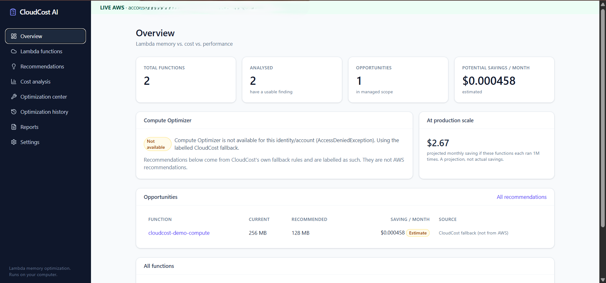
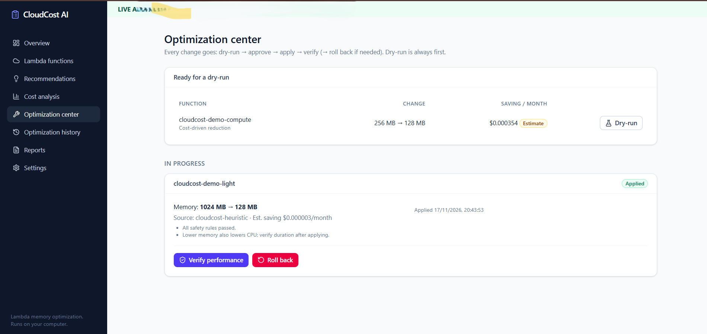
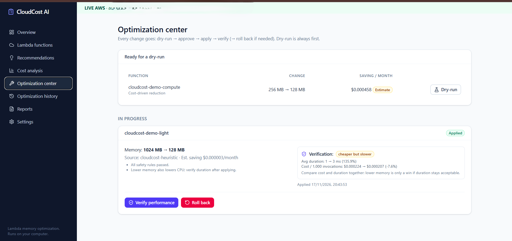
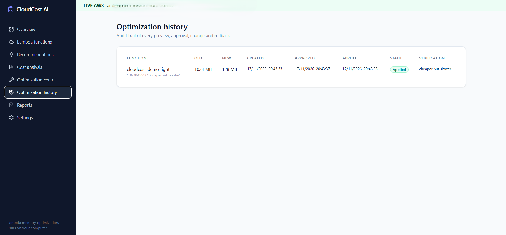

# CloudCost AI

**AWS Lambda cost-optimization and performance-monitoring platform.**
It reads your Lambda functions and their CloudWatch metrics, recommends a better memory size, applies the change safely (dry-run, approval, backup, verification, rollback) and keeps an audit trail.

Everything runs on your own computer. Only the Lambda functions live on AWS, so there is no server or database to pay for, and the whole project fits inside the AWS Free plan.

> Built for the Cloud Computing *Tool Explorer* assignment (SRMIST).
> Tool explored: **Amazon Web Services**, with AWS Lambda, CloudWatch, Compute Optimizer, IAM and Budgets.

---

## Table of contents

1. [Why this project](#why-this-project)
2. [Features](#features)
3. [Screenshots](#screenshots)
4. [Architecture](#architecture)
5. [Tech stack](#tech-stack)
6. [Project structure](#project-structure)
7. [Quick start (demo mode)](#quick-start-demo-mode)
8. [Go live on AWS](#go-live-on-aws)
9. [Configuration](#configuration)
10. [How the optimization works](#how-the-optimization-works)
11. [Safety design](#safety-design)
12. [Helper scripts](#helper-scripts)
13. [Testing](#testing)
14. [Cost of running this](#cost-of-running-this)
15. [Troubleshooting](#troubleshooting)
16. [Cleanup](#cleanup)
17. [Limitations and roadmap](#limitations-and-roadmap)
18. [Documentation](#documentation)
19. [Authors](#authors)

---

## Why this project

A Lambda function has one main tuning setting: **memory** (128 MB to 10,240 MB). Memory also decides how much CPU the function gets, and the bill is based on memory x run time. Most people guess the number, so functions are often over-provisioned (wasted money) or under-provisioned (slow).

```
Compute cost = memory (GB) x duration (s) x invocations x price per GB-second
Total cost   = compute cost + invocations x $0.20 per 1 million requests
```

CloudCost AI measures real usage, recommends a memory size, applies it safely and then checks whether the change actually helped.

## Features

- **Inventory** of all Lambda functions in a region (memory, runtime, timeout).
- **Metrics** from CloudWatch: invocations, duration and peak memory used.
- **Recommendations** from AWS Compute Optimizer, passed through unchanged. If it has no data yet, a labelled fallback heuristic is used instead.
- **Cost analysis** with monthly savings and a production-scale projection.
- **Optimization center** with the workflow: dry-run, approve, apply, verify, roll back.
- **Optimization history**: an audit trail of every preview, approval, change and rollback.
- **Reports** exported as CSV/JSON.
- **Demo mode** with built-in sample data, so everything works without an AWS account.
- **Honest labelling**: every figure is marked `AWS figure`, `Estimate` or `Demo`.

## Screenshots

| Overview | Optimization center |
|---|---|
|  |  |

| Verification | History |
|---|---|
|  |  |

## Architecture

```
React dashboard (localhost:5173)
        |  /api proxy
        v
FastAPI backend (127.0.0.1:8000)  ----  Python engine (pure logic, no AWS calls)
        |
        v
Boto3 (one shared session, AWS CLI profile)
        |
        v
AWS (one region): Lambda · CloudWatch · Compute Optimizer
        
Local storage: data/ (JSON snapshots, backups, audit trail) and reports/ (CSV/JSON)
```

Design choices:

- The browser never sees AWS credentials. It only talks to the backend on `127.0.0.1`.
- The engine has no AWS calls, so all the logic is unit-tested with plain data.
- Local JSON/CSV files replace a database, so there is nothing extra to pay for or run.

## Tech stack

| Layer | Technology |
|---|---|
| Frontend | React 18, TypeScript, Vite, Tailwind CSS v4, Recharts, lucide-react |
| Backend | Python, FastAPI, Uvicorn, Boto3, PyYAML |
| Logic | Pure-Python engine (`engine/`) |
| Storage | Local JSON and CSV files |
| Tests | Pytest (39 mocked tests, zero AWS calls) |
| Cloud | AWS Lambda, CloudWatch, Compute Optimizer, IAM, Budgets |

## Project structure

```
cloudcost-ai/
├── backend/
│   ├── requirements.txt
│   └── app/
│       ├── main.py            # FastAPI app
│       ├── core/              # config, security guards, logging
│       ├── aws/               # Boto3 session and AWS clients, demo data
│       ├── services/          # glue between AWS clients and the engine
│       ├── schemas/           # request/response models
│       └── api/routes/        # health, aws, lambda_functions, metrics,
│                              # recommendations, optimization, reports
├── engine/                    # inventory, metrics analysis, savings,
│                              # rules, recommendations, approval, backup,
│                              # updater, rollback, performance comparison
├── frontend/                  # React dashboard (src/, public/)
├── scripts/                   # AWS setup, load generation, cleanup, IAM policy
├── tests/                     # mocked unit tests
├── data/                      # local snapshots, backups, history (git-ignored)
├── reports/                   # generated reports (git-ignored)
├── docs/                      # setup, architecture, API, cost, viva notes
├── config.yaml                # settings and safety limits
├── .env.example               # environment variable template
└── README.md
```

## Quick start (demo mode)

Needs: Python 3.10+ and Node.js 18+. No AWS account is required.

**Windows (PowerShell)**

```powershell
# 1. Backend (from the project root)
py -m venv .venv
.venv\Scripts\activate
pip install -r backend\requirements.txt
uvicorn backend.app.main:app --port 8000

# 2. Frontend (a second terminal)
cd frontend
npm install
npm run dev
```

**macOS / Linux**

```bash
python3 -m venv .venv && source .venv/bin/activate
pip install -r backend/requirements.txt
uvicorn backend.app.main:app --port 8000

cd frontend && npm install && npm run dev
```

Open http://localhost:5173. In demo mode the banner says **DEMO** and all data is sample data.

## Go live on AWS

Full details are in [`docs/aws_setup.md`](docs/aws_setup.md). The short version:

1. **Account.** Create an AWS account on the Free plan and set an AWS Budgets alert.
2. **IAM.** Create two users:
   - `cloudcost-admin` with `AdministratorAccess`, for one-time setup only.
   - `cloudcost-app` with the policy in [`scripts/iam_policy.json`](scripts/iam_policy.json), for the app. This is least privilege.
3. **AWS CLI.** Install it, then create a named profile for each user:
   ```powershell
   aws configure --profile cloudcost-admin
   aws configure --profile cloudcost
   ```
   Keep access keys **outside** this folder. Never commit them.
4. **Region.** Use a region your account is allowed to use. Some organizations restrict regions with a service control policy (SCP). Set the same region in `config.yaml`, `.env` and your CLI profile.
5. **Verify access.**
   ```powershell
   $env:AWS_PROFILE="cloudcost"; $env:AWS_REGION="ap-southeast-2"
   python scripts\verify_aws.py
   ```
6. **Compute Optimizer.** Opt in once from the console (no extra charge; first recommendations can take up to 24 hours).
7. **Create demo functions and load.**
   ```powershell
   python scripts\create_test_functions.py
   python scripts\generate_load.py 60
   ```
8. **Switch mode** in `config.yaml`: set `mode: aws`. Real changes stay blocked until you also set `allow_writes: true`. Restart the backend and refresh the page.

## Configuration

`config.yaml` (environment variables override it):

| Key | Default | Meaning |
|---|---|---|
| `mode` | `demo` | `demo` uses sample data; `aws` uses your real account |
| `region` | `ap-south-1` | AWS region to read and change. Set it to your allowed region |
| `profile` | empty | AWS CLI profile name |
| `lookback_days` | `14` | Analysis window (same as Compute Optimizer) |
| `metrics_cache_minutes` | `10` | Reuse CloudWatch results to avoid repeat API calls |
| `allow_writes` | `false` | Must be `true` before any real AWS change can be applied |
| `managed_prefix` | `cloudcost-demo-` | Only functions with this name prefix can be changed |
| `max_reduction_pct` | `75` | Refuse a single step that cuts memory by more than this |
| `min_monthly_savings_usd` | `0.0` | Ignore recommendations below this saving |
| `pricing.*` | see file | Lambda list prices used for estimates |

Environment variables (see `.env.example`): `CLOUDCOST_MODE`, `AWS_PROFILE`, `AWS_REGION`, `CLOUDCOST_ALLOW_WRITES`.

## How the optimization works

1. **Collect.** List functions, then read CloudWatch metrics and the Lambda log `REPORT` line, which holds *Max Memory Used*.
2. **Recommend.**
   - If Compute Optimizer has a finding, use it unchanged (labelled `AWS figure`).
   - Otherwise use the fallback: `peak memory x 1.3`, rounded to 64 MB, labelled **CloudCost fallback (not from AWS)**.
   - Compute Optimizer needs 50+ invocations in 14 days and memory of 1792 MB or less.
3. **Estimate savings** with the cost formula. For memory increases no saving is shown unless AWS provides one.
4. **Change safely.** `dry-run -> approve -> apply -> verify -> roll back`.
5. **Verify.** Compare average duration and cost per 1,000 invocations before and after. The verdict can be, for example, *cheaper but slower*.

A note on small numbers: at very low volume the flat `$0.20 per 1M requests` fee dominates the bill, so a large slowdown can still show only a small cost change. The projection to production scale is shown separately and is labelled as a projection.

## Safety design

- Credentials come from your AWS CLI profile, never from code or the browser.
- The backend listens on `127.0.0.1` only.
- Writes are off by default (`allow_writes: false`).
- Only functions named `cloudcost-demo-*` can be changed (`managed_prefix`).
- Dry-run first, then explicit approval, then a configuration backup and a **drift check** (stops if the function changed since the preview).
- A single-step reduction limit (`max_reduction_pct`) and one-click rollback.
- Every action is written to the audit trail.
- Real, estimated and demo figures are labelled everywhere. Unavailable recommendations show "awaiting data", not an invented number.

## Helper scripts

| Script | Purpose |
|---|---|
| `scripts/verify_aws.py` | Check credentials, Lambda access and Compute Optimizer access |
| `scripts/create_test_functions.py` | Create the demo functions (`cloudcost-demo-*`) |
| `scripts/generate_load.py N` | Invoke the demo functions N times so CloudWatch has data |
| `scripts/collect_data.py` | Pull metrics and recommendations into `data/` |
| `scripts/cleanup.py` | Delete the demo functions created by this project |
| `scripts/iam_policy.json` | Least-privilege policy for the app user |

## Testing

```powershell
python -m pytest
```

39 tests. All AWS calls are mocked, so running them costs nothing and needs no account.

## Cost of running this

On the AWS Free plan the project costs about **$0**:

- Lambda free allowance: 1M requests and 400,000 GB-seconds a month.
- CloudWatch: the app uses `GetMetricStatistics`, which is free-tier safe (`GetMetricData` is always billed, so it is not used).
- Compute Optimizer: no additional charge.
- Set an AWS Budgets alert anyway.

See [`docs/cost_management.md`](docs/cost_management.md).

## Troubleshooting

| Problem | Cause and fix |
|---|---|
| `AccessDeniedException` on Lambda | An organization SCP may allow only certain regions. Switch to the allowed region everywhere (config, `.env`, CLI profile). |
| `AccessDeniedException` on Compute Optimizer | Opt in to Compute Optimizer, and make sure the app policy includes the `compute-optimizer:*` read actions. |
| Compute Optimizer shows "Not available" | New opt-in can take up to 24 hours, and Lambda needs 50+ invocations in 14 days. The labelled fallback is used meanwhile. |
| Update waiter fails | Make sure the app policy includes `lambda:GetFunction` (it is in `scripts/iam_policy.json`). |
| Banner says "read-only" after enabling writes | The banner is read at page load. Restart the backend and refresh (F5). |
| Reduction refused | The change exceeds `max_reduction_pct`. Raise it in `config.yaml` if you accept the risk. |
| Frontend cannot reach the API | Check the backend is running on port 8000; the Vite dev server proxies `/api` to `127.0.0.1:8000`. |

## Cleanup

When you are completely done (for example after your viva):

```powershell
python scripts\cleanup.py
```

This deletes the demo functions. Then, if you want, delete the IAM access keys, the IAM users and the budget in the AWS console. Free-plan accounts also close automatically when the plan expires unless you upgrade.

## Limitations and roadmap

**Limitations**

- Memory is the only setting tuned (not timeout, ARM architecture or provisioned concurrency).
- The fallback heuristic uses peak memory only. It does not benchmark your code at different sizes.
- One region and one account at a time.
- With very few invocations, numbers are tiny and noisy.

**Roadmap**

- Benchmark-based tuning (try several memory sizes automatically).
- ARM (Graviton) recommendations.
- Scheduled reports and alerts.
- Multi-region and multi-account support.

## Documentation

- [`docs/aws_setup.md`](docs/aws_setup.md): detailed AWS setup
- [`docs/architecture.md`](docs/architecture.md): design
- [`docs/api_documentation.md`](docs/api_documentation.md): backend endpoints
- [`docs/cost_management.md`](docs/cost_management.md): staying within the Free plan
- [`docs/viva_questions.md`](docs/viva_questions.md): viva preparation


SRM Institute of Science and Technology · Cloud Computing · Tool Explorer

## License

Add a license of your choice (for example MIT) as `LICENSE`. This is a student project provided as-is, without warranty. You are responsible for any AWS charges in your own account.